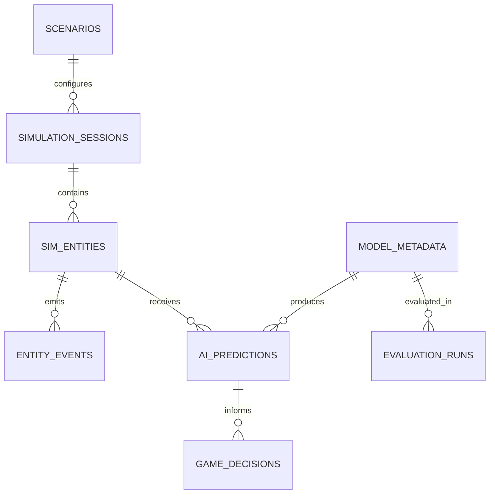

# Data Model — SkyShield AI

## 1. Storage strategy
IndexedDB is the primary persistence layer for the initial release. It works without a hosted database and does not require an account or payment method.

Export/import of JSON files provides portable backups. Hosted PostgreSQL is optional and deferred.

## 2. Logical entities
- `simulation_sessions`: one user-run simulation.
- `scenarios`: scenario definitions and generation settings.
- `sim_entities`: fictional entities observed during a session.
- `entity_events`: state changes and game events.
- `ai_predictions`: model output and model version.
- `game_decisions`: game-only priority decisions.
- `model_metadata`: local metadata for model artifacts.
- `evaluation_runs`: measured evaluation results.

## 3. ER diagram

## 4. Record requirements
### simulation_sessions
`session_id`, `scenario_id`, `seed`, `simulation_version`, `model_version`, `started_at`, `ended_at`, `settings_json`, `score`.

### sim_entities
`entity_id`, `session_id`, `entity_class`, `tracking_state`, `first_seen_at`, `last_seen_at`.

### entity_events
`event_id`, `session_id`, `entity_id`, `event_type`, `simulation_time_ms`, `payload_json`.

### ai_predictions
`prediction_id`, `session_id`, `entity_id`, `predicted_class`, `confidence`, `model_version`, `latency_ms`.

### game_decisions
`decision_id`, `session_id`, `entity_id`, `priority`, `reason_code`, `decision_version`.

## 5. Data quality
- Use stable IDs.
- Store timestamps and simulation time separately.
- Preserve model and schema versions.
- Do not infer negative labels from missing observations.
- Keep train/validation/test scenario IDs disjoint.
- Exclude session identifiers and random seeds from model features unless explicitly justified.
